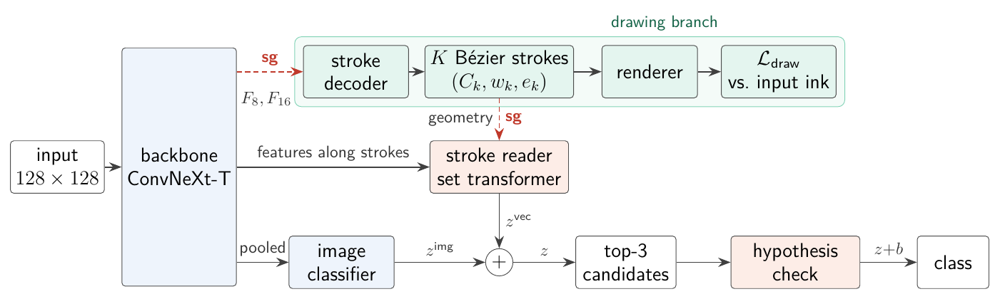
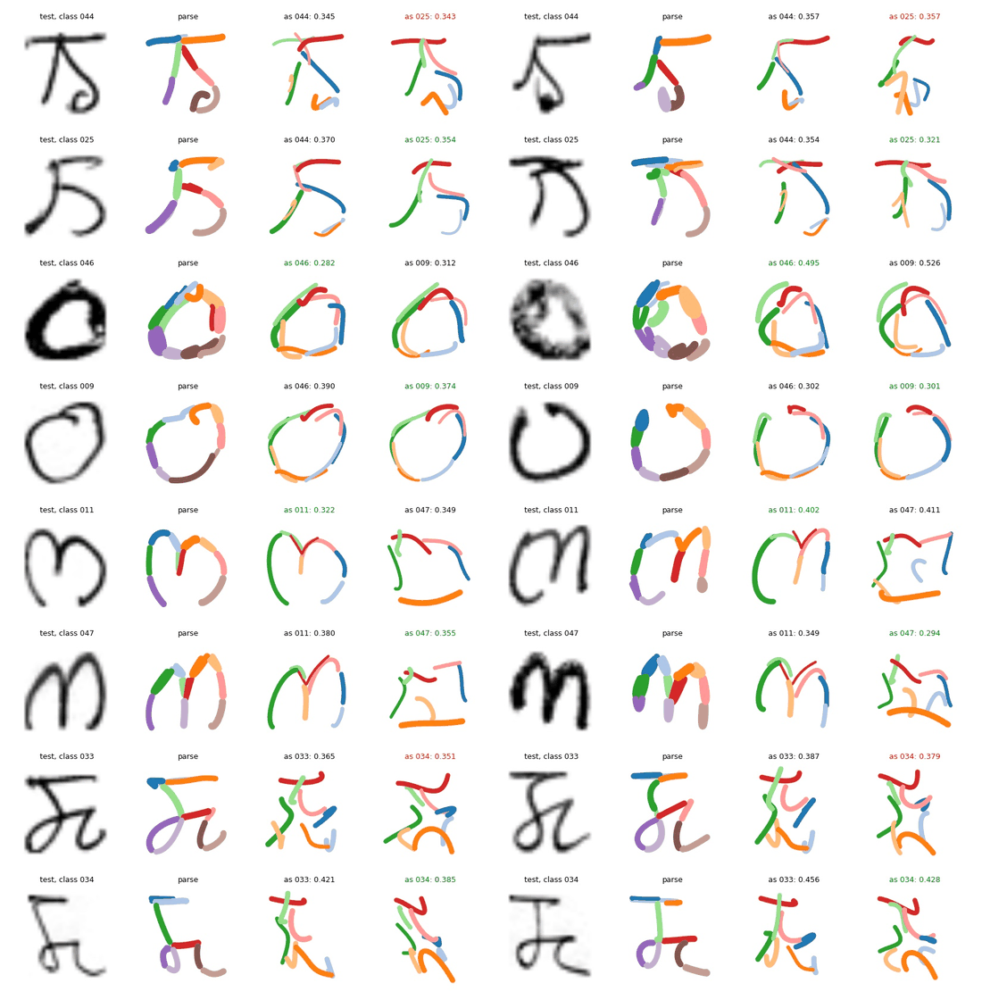
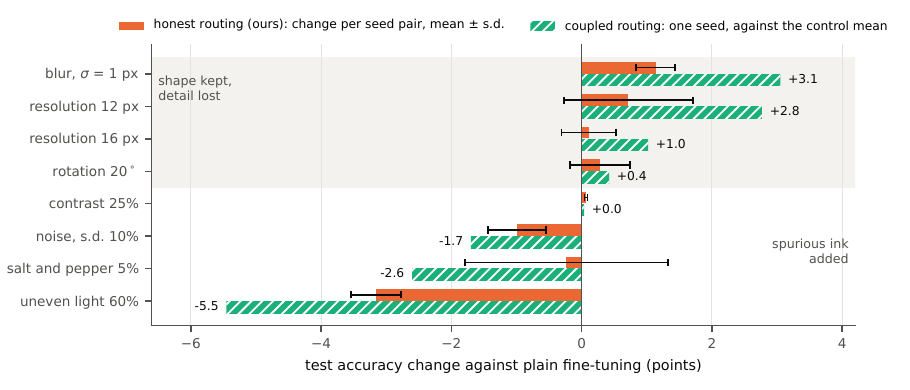
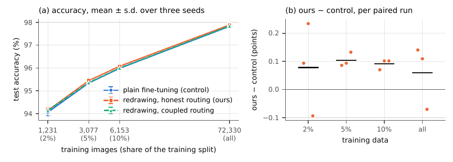

# Reading by redrawing

**Stroke reconstruction and honest gradient routing for handwritten Meitei Mayek recognition**

Most handwriting recognisers name a character and stop there. This project builds a recogniser
for the 55 classes of handwritten Meitei Mayek that also redraws what it reads. Alongside its
prediction it returns the character as a small set of cubic Bézier pen strokes, learned without a
single stroke label, and it checks its leading guesses by bending learned stroke templates of each
candidate class onto the image. The code here produced every number and figure in the
accompanying paper (under review).



## How it works

**Stroke decoder and renderer.** A pretrained ConvNeXt-T reads the image. A stroke decoder with
12 learned queries attends to its stride-8 and stride-16 feature maps and predicts up to 12
strokes, each a cubic Bézier curve with a width and an existence probability. A differentiable
renderer draws the strokes from their distance field, and the drawing is compared with the input
ink. That comparison is the only thing that teaches the decoder what a stroke is: there are no
stroke labels and no online (pen-trajectory) data for Meitei Mayek.

**Stroke reader.** Every stroke becomes a token: its shape, its width relative to the character
box (which may carry a cue to the size the character was written at), and the backbone features sampled
along it. A small set transformer classifies the set of tokens, and its logits are added to those
of the ordinary image classifier.

**Hypothesis check.** Every class owns two templates of eight strokes, learned from the training
images. For the three best candidates, a fitter predicts how to bend each template onto the image
(an affine map plus a bounded offset for every control point). The bent template is rendered and
scored by how well it explains the ink and how far it had to bend. The scores re-rank the
candidates, and the parse and the bent templates are returned with every decision.

**Honest gradient routing.** Trained end to end, these parts cost the recogniser accuracy: the
drawing loss pulls the shared backbone away from what classification needs, and the classifier
moves the strokes to wherever they help it, so they stop describing the ink. Honest routing lets
each loss reach only the parts it is meant to explain:

| loss | what it may train |
|---|---|
| classification | backbone, image classifier and stroke reader, but never the strokes themselves |
| drawing | the stroke decoder only, which reads the backbone through a stop-gradient |
| template fit | the fitter, which learns to fit every hypothesis as well as it can, right or wrong |
| template margin and discrimination | the templates (and two scalars), with the fitter frozen |

In code this is `route="honest"` in `redraw/model.py`. `route="coupled"` is the ablation in which
every loss reaches every part, and `draw_grad` lets a chosen fraction of the drawing gradient back
into the backbone.

## Results

TUMMHCD test set, 12,794 images. Every design decision was made on a validation split held out
from the training images; the final networks were trained with three seeds on all 72,330
training images, and the test set was predicted once.

| method | accuracy (%) |
|---|---|
| HOG + SVM (Hijam, 2024) | 93.98 |
| EfficientNet-B3, transfer learning (Hijam, 2024) | 95.21 |
| compact CNN (Hijam and Saharia, 2022) | 95.56 |
| multilevel feature fusion (Hijam and Saharia, 2024) | 97.08 |
| ConvNeXt-T, same recipe without strokes (control) | 97.83 ± 0.07 |
| redrawing, coupled routing (one seed) | 97.84 |
| **redrawing, honest routing** | **97.89 ± 0.06** |
| **honest routing, average of the three seeds** | **97.94** |

- The recogniser redraws test characters with about ten strokes and a rendered-ink F-score of
  0.93, without ever seeing a stroke label. This measures agreement with the ink, not with the
  writer's pen strokes.
- It is ahead of the control in 10 of 12 paired runs with full and reduced training data (mean
  +0.08 points, exact Wilcoxon p = 0.008, conditional on this test set). Most of its margin over
  earlier published results comes from the backbone and recipe it shares with the control, and
  four look-alike pairs cause 54-59% of the remaining errors.
- The hypothesis check does not add accuracy (11 errors fixed, 14 introduced over three seeds);
  what it adds is the display of bent templates.
- Letting the drawing loss reach the backbone changes which corruptions hurt: +3.1 points under
  heavy blur and +2.8 at 12-pixel resolution, -5.5 under strongly uneven lighting, with a similar
  mean over all corruptions.







The numbers behind every table and figure are in [`results/`](results/).

## Dataset

The experiments use the Tezpur University Meitei Mayek Handwritten Character Database (TUMMHCD),
introduced by Hijam and Saharia in
[*The Visual Computer* 38, 525-539 (2022)](https://link.springer.com/article/10.1007/s00371-020-02032-y):
85,124 images of isolated characters in 55 classes, with an official split of 72,330 training and
12,794 test images. The original download page is offline. A copy of the official archive
(`TUMMHCD-TEST-TRAIN.zip`, 55 MB) is available on
[Google Drive](https://drive.google.com/file/d/1aUc15b-LAgJCExAx5C8E3-tCqQdtkaS7/view), and the
code downloads it from there when no local copy is found.

Validation is 15% of every training class, shuffled with seed 42, which gives 61,504 / 10,826 /
12,794 training, validation and test images:

```bash
python -m redraw.split --data-dir data                                  # download and split
python -m redraw.split --zip TUMMHCD-TEST-TRAIN.zip --data-dir data     # or use a local copy
```

## Reproducing the experiments

The experiments were run in Google Colab, in the order below. Each notebook keeps its trained
networks and predictions on Google Drive, so after a disconnect it can simply be run again.

| notebook | what it does |
|---|---|
| [`round1`](notebooks/round1.ipynb) | the method with and without the hypothesis check, the plain network, and strokes that are never compared with the ink |
| [`round2`](notebooks/round2.ipynb) | StrokeWarp (training images deformed along their own parse), end-to-end versus honest check training, the check without the stroke reader |
| [`diagnostics`](notebooks/diagnostics.ipynb) | float32 control, how much the networks disagree, a nearest-neighbour memory |
| [`round3`](notebooks/round3.ipynb) | honest routing, other pretrainings and 224 px input, test-time redrawing, reduced data, damaged scans (validation only) |
| [`final`](notebooks/final.ipynb) | final networks on training + validation, the test set once, familiarity analysis, damaged scans, reduced data |

Open a notebook in Colab with
`https://colab.research.google.com/github/chingkheinganba231005/Meitei-Mayek-Redraw/blob/main/notebooks/<name>.ipynb`
and choose a large GPU runtime; the final networks were trained on a G4 runtime (one NVIDIA RTX
PRO 6000 Blackwell). In round 3, one network of the method trained in about 35 minutes on the
development split and the control in about 11.

### Further experiments

A second set of notebooks tests the parts of the method one at a time. They reuse the networks
above (same Drive folder), record the data and split hashes and the environment of every session,
and write their results to `MyDrive/redraw/revision`, with a ZIP of everything small in
`revision/exports`. Every step can be interrupted and run again.

| notebook | what it does | GPU time |
|---|---|---|
| [`rev1_audit`](notebooks/rev1_audit.ipynb) | unit tests; which loss trains which parameters, for every configuration; the learned check scales; sampled against exact rendering; paired tests, per-class results and check transitions from the saved predictions; cost | 30 min |
| [`rev2_core`](notebooks/rev2_core.ipynb) | development split: the two routing rules in a 2 x 2 design, readers that see only geometry, only features or a fixed grid, slots without a rendering loss, staged training on a frozen control (three seeds) | 10 h |
| [`rev3_reconstruction`](notebooks/rev3_reconstruction.ipynb) | reconstruction against skeleton tracing and per-image optimisation, stability of the parse, probes, stroke erasure with controls, the check (transitions, margins, selective prediction, refitting), figures | 2 h |
| [`rev4_seeds_robustness`](notebooks/rev4_seeds_robustness.ipynb) | seeds 3 and 4 of the control and the method, seeds 1 and 2 of coupled routing, damaged images before and after preprocessing, texture against shape, the routing dial on validation | 6 h |
| [`rev5_second_dataset`](notebooks/rev5_second_dataset.ipynb) | the Devanagari Handwritten Character Dataset with the same recipe: control, method and coupled routing, three seeds each | 5 h |

Run `rev1_audit` first and once more at the end. The notebooks are built from the `.py` files next
to them with `python notebooks/make_ipynb.py`.

## Using the code

```bash
pip install -r requirements.txt
python -m pytest            # CPU tests, about a minute
```

```python
from redraw.data import Store, build_cache, load_index
from redraw.model import CONFIGS
from redraw.split import make_split
from redraw.train import predict, train

splits, _ = make_split("TUMMHCD-TEST-TRAIN.zip", "data")
index, labels, idx = load_index(splits)
store = Store(build_cache(index.file.tolist(), 128, "cache"), "cuda", idx["train"])
cfg = dict(CONFIGS["redraw_hdr_hr"], seed=0)          # the method with honest routing
model = train("redraw_hdr_hr", cfg, idx["train"], "s0", store, labels, "work", val_idx=idx["val"])
probs = predict(model, idx["test"], cfg, store)["logits"]
```

## Repository layout

| path | contents |
|---|---|
| `redraw/model.py` | the network, honest and coupled routing, and every configuration used in the paper |
| `redraw/render.py` | differentiable stroke rendering, the drawing losses and the parse score |
| `redraw/train.py` | training loop (weight averaging, resumable checkpoints), prediction, parse and check evaluation |
| `redraw/strokewarp.py` | StrokeWarp and test-time redrawing |
| `redraw/erase.py` | the stroke-erasure test of the explanations |
| `redraw/explain.py` | interventions on the reader's input, recognition from the drawings, analysis of the check |
| `redraw/audit.py` | which loss trains which parameters, as an executable check |
| `redraw/recon.py` | reconstruction metrics, the skeleton and optimisation baselines, parse stability |
| `redraw/analysis.py`, `stats.py` | McNemar tests, bootstrap intervals, paired comparisons across seeds, familiarity, risk-coverage curves |
| `redraw/bench.py`, `manifest.py` | cost measurements; hashes, environment records and result archives |
| `redraw/experiments.py` | the further experiments, one function each |
| `redraw/paper_numbers.py` | every number of the paper recomputed from the results files |
| `redraw/split.py`, `preprocess.py`, `data.py`, `augment.py`, `robustness.py` | data split, preprocessing, GPU augmentation and synthetic damage |
| `notebooks/` | the experiments, as notebooks and as plain Python scripts |
| `results/` | the results files written by the notebooks |
| `tests/` | CPU tests |

## Citation

```bibtex
@misc{rajkumar2026redraw,
  author = {Rajkumar, Chingkheinganba},
  title  = {Reading by redrawing: stroke reconstruction and honest gradient routing
            for handwritten {Meitei Mayek} recognition},
  year   = {2026},
  note   = {Manuscript under review. Code: https://github.com/chingkheinganba231005/Meitei-Mayek-Redraw}
}
```

Please also cite the dataset:

```bibtex
@article{hijam2022database,
  author  = {Hijam, Deena and Saharia, Sarat},
  title   = {On developing complete character set {Meitei Mayek} handwritten character database},
  journal = {The Visual Computer},
  volume  = {38},
  pages   = {525--539},
  year    = {2022},
  doi     = {10.1007/s00371-020-02032-y}
}
```

## Licence

MIT, see [LICENSE](LICENSE). TUMMHCD belongs to its creators; please follow their terms when using
it.
